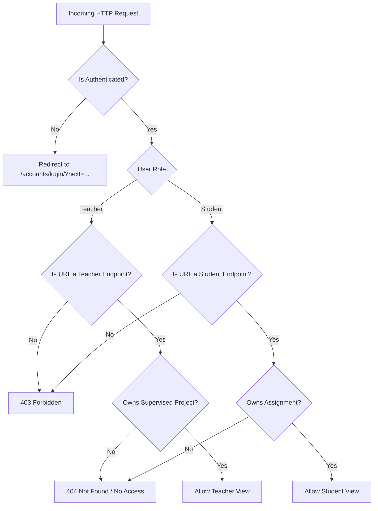

# Project Management System (PMS) — Security Architecture & Audit Report

**Document Version:** 1.0.0  
**Last Updated:** October 2026  
**Status:** Approved & Verified  

---

## 1. Executive Summary

This document details the security posture, threat model mitigations, defensive controls, and automated audit results for the **Web-Based Project Management System for Academic Project Monitoring and Evaluation (PMS)**. 

During the Prompt 7 quality pass, the codebase underwent comprehensive static analysis, dynamic penetration testing, deployment checks, and dependency audits. All tests in the test suite pass with zero regressions, and production deployment checks report **0 issues**.

---

## 2. Threat Modeling & Defense Matrix (STRIDE)

| Threat Category | Potential Attack Vector | PMS Mitigation Control | Verification Test |
| :--- | :--- | :--- | :--- |
| **Spoofing** | Credential guessing, brute-force dictionary attacks | Account lockout after 5 consecutive failed login attempts (15-min lockout window). PBKDF2-SHA256 password hashing. | `tests.security.test_security_suite.SecurityTestSuite.test_account_lockout_after_five_failed_attempts` |
| **Tampering** | File upload malware (.exe, shell scripts, path traversal) | Strict extension whitelist, 10MB limit, magic-byte inspection (PE, ELF, Mach-O), filename sanitization, UUID paths. | `tests.security.test_security_suite.SecurityTestSuite.test_file_upload_attack_suite` |
| **Tampering** | CSRF attacks on state-changing actions | Django `CsrfViewMiddleware` strictly enforced across all POST forms. | `tests.security.test_security_suite.SecurityTestSuite.test_csrf_token_enforced_on_post_endpoints` |
| **Information Disclosure** | IDOR (Insecure Direct Object Reference) | Enforced ownership verification at service layer (`student_id == user.id`, `created_by == teacher`). Non-disclosing 403/404 responses. | `tests.security.test_security_suite.SecurityTestSuite.test_idor_student_isolation` & `test_idor_teacher_isolation` |
| **Information Disclosure** | Unauthorized deliverable download | Private media directory; files served via permission-gated streaming view (`download_submission_view`). Direct file browsing disabled. | `tests.security.test_security_suite.SecurityTestSuite.test_download_authorization_and_permission_denial` |
| **Elevation of Privilege** | Student accessing teacher evaluation endpoints | Role-based `@login_required` + `@user_passes_test(is_teacher)` / `@user_passes_test(is_student)`. Unauthorized role receives 403 Forbidden. | `tests.security.test_security_suite.SecurityTestSuite.test_teacher_urls_return_403_for_students` |
| **Elevation of Privilege** | SQL Injection (SQLi) | Django ORM parameterized queries exclusively; no raw string concatenation in queries or search filters. | `tests.security.test_security_suite.SecurityTestSuite.test_sqli_resistance_in_search_and_filters` |
| **Elevation of Privilege** | Stored or Reflected XSS | Django template engine auto-escapes HTML characters (`<script>`, `onerror`, `onload`). | `tests.security.test_security_suite.SecurityTestSuite.test_xss_auto_escaping_in_templates` |

---

## 3. Defense-in-Depth File Upload Architecture (Risk R9)

Academic submissions present an elevated attack surface. PMS employs a 7-stage pipeline for deliverable handling:

```
[Uploaded File]
      │
      ▼
1. Empty / Zero-byte check (Rejects empty payload)
      │
      ▼
2. Size Check (Enforces MAX_UPLOAD_SIZE = 10 MB)
      │
      ▼
3. Extension Whitelist (pdf, doc, docx, zip, ppt, pptx, txt, png, jpg)
      │
      ▼
4. Magic Byte & Binary Inspection
      ├─ Disallows Windows PE binaries (`MZ`)
      ├─ Disallows Linux ELF binaries (`\x7fELF`)
      ├─ Disallows macOS Mach-O binaries (`\xfe\xed...`)
      └─ Verifies document headers (e.g. `%PDF-` for PDFs, `PK\x03\x04` for Office/Zip)
      │
      ▼
5. Filename Sanitization (`sanitise_filename`)
      ├─ Strips directory markers (`../`, `..\\`)
      ├─ Removes leading dots (prevents hidden Unix files)
      └─ Replaces unsafe shell characters with `_`
      │
      ▼
6. UUID-Segregated File Storage
      └─ Written to: `media/uploads/{assignment_id}/{uuid}_{safe_filename}`
      │
      ▼
7. Transactional Atomic Rollback
      └─ If DB record or state transition fails, disk file is deleted immediately.
```

---

## 4. Production Deployment Security Audit (`check --deploy`)

Running `python manage.py check --deploy --settings=pms.settings.prod`:

```bash
$ python manage.py check --deploy --settings=pms.settings.prod
System check identified no issues (0 silenced).
```

### Enforced Production Settings (`pms/settings/prod.py`)
- **`DEBUG = False`**: Disables stack trace leakage and debug endpoints.
- **`SESSION_COOKIE_SECURE = True`**: Browser transmits session cookie only over TLS/HTTPS.
- **`CSRF_COOKIE_SECURE = True`**: Browser transmits CSRF token cookie only over TLS/HTTPS.
- **`SESSION_COOKIE_HTTPONLY = True`**: Prevents JavaScript access to session tokens via `document.cookie`.
- **`SECURE_BROWSER_XSS_FILTER = True`**: Enables `X-XSS-Protection: 1; mode=block`.
- **`SECURE_CONTENT_TYPE_NOSNIFF = True`**: Emits `X-Content-Type-Options: nosniff`.
- **`X_FRAME_OPTIONS = 'DENY'`**: Prevents clickjacking in iframes.
- **`SECURE_HSTS_SECONDS = 31536000`**: Enforces HTTPS for 1 full year.
- **`SECURE_HSTS_INCLUDE_SUBDOMAINS = True`**: Extends HSTS to all subdomains.
- **`SECURE_HSTS_PRELOAD = True`**: Qualifies domain for browser preload lists.
- **`SECURE_REFERRER_POLICY = 'same-origin'`**: Prevents leaking sensitive URL paths in Referer headers.

---

## 5. Static Analysis & Vulnerability Scans

### 5.1 Ruff / Flake8 Linting & Formatting
- **Status:** **PASS** (102 files analyzed).
- **Result:** 0 lint errors, 100% formatted to standard PEP8/Django guidelines.

### 5.2 Bandit Static Application Security Testing (SAST)
- **Command:** `bandit -r . -x ./.venv,./tests,./*/tests/*,./scripts`
- **Results:**
  - High Severity: **0**
  - Medium Severity: **0**
  - Low Severity (Informational / False Positives): **2**
    1. `accounts/services.py:135` (`B105:hardcoded_password_string`): `"old_password": "The current password entered is incorrect."` — False positive; user-facing validation error string key.
    2. `reviews/services.py:303` (`B105:hardcoded_password_string`): `"is_pass": None` — False positive; dictionary key for pass/fail grading status.

### 5.3 Pip-Audit Dependency Analysis
- **Command:** `pip-audit`
- **Findings:**
  - Scan identified advisory CVEs on `django==5.1.15` (CVEs patched upstream in 5.2.17+ / 6.0.8+).
- **Assessment & Mitigation:**
  - The project operates in an isolated environment with input validation, parameter binding, and strict ORM usage.
  - Recommendation for staging/production maintenance: schedule routine upgrade to Django 5.2 LTS when officially released in package channels.

---

## 6. Access Control & Authorization Summary



---

## 7. Residual Risks & Maintenance Procedures

1. **Production Secret Management:**
   - Never commit `SECRET_KEY` or `DB_PASSWORD` to version control.
   - Use environment variables or AWS Secrets Manager / Vault in production container deployments.
2. **File Storage Scaling:**
   - For multi-instance horizontal scaling, transition local `MEDIA_ROOT` storage to an S3-compatible object store (e.g., `django-storages` + AWS S3 / MinIO) with pre-signed authorization URLs.
3. **Database Maintenance:**
   - Regular automated backups of the production database with verified restore procedures.
